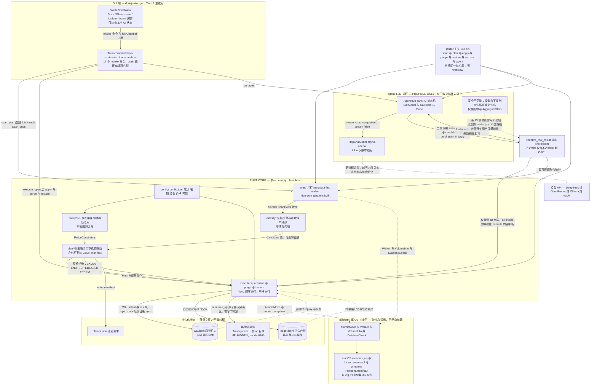

### 1. 痛点分析

用户面对一块快满的磁盘时，真正缺的不是"字节在哪"，而是两个判断：**这个能不能删**，以及**删错了怎么拿回来**。核心论断是——判断（can this be deleted?）与可逆性（what if I'm wrong?）占掉了清理工作的绝大部分，而目前没有任何工具把这两端端到端地握在手里。

**一、能不能删：全是名字匹配与黑盒规则。** `du` / `ncdu` 只回答字节分布，没有任何安全判断，两次运行之间也不留记忆——下周打开，同一个目录还得从头再判断一次。CleanMyMac 把判断交给专有的 Safety Database（自 2008 年累积的人工维护规则加例外），但规则本身不可检视，也没有 lockfile、重建代价这类机器推理。AppCleaner 用 bundle-id 与名字启发式匹配"残留文件"，一旦假阳性，没有任何证据链可以追溯。macOS 自带的存储管理有很好的 no-op-first 哲学（先回收 purgeable），却把大量内容塞进不透明的 "System Data" 聚合里，既无证据链，也无跨会话记忆。命名匹配正是本项目要取代的失败模式。

**二、删错了怎么办：撤销通道普遍不存在。** DaisyDisk 的 Collector 看起来最像"先看再删"——收集、复核、删除、5 秒倒计时——但官方文档写明删除是永久 unlink，文件 "cannot be 'undeleted'"：5 秒倒计时不是撤销，只是一个更短的确认框。CleanMyMac 默认移到废纸篓，可回收性在废纸篓清空那一刻结束，而 "Remove Securely" 是**故意做成不可逆**的。更糟的是"一键"的默认值：CleanMyMac Smart Care 默认把五个模块全部勾选，OnyX 把底部若干 Cleaning 项预先打勾；在被调查的六款一键清理工具中，只有 DevCleaner 把自动勾选限制在 SAFE 一档，其余都会为不可逆的操作预先打勾。

**三、说清楚删了什么：收据是终局的一次性数字。** CleanMyMac 只回一句"已优化"，MacBooster 说"几秒内释放"，Sensei 给一个回收汇总——都是先给一个释放字节数，然后结束。CCleaner 的 Results 页会列出被清理的类别与释放的空间，是同类中信息最全的，但同样是终局收据，没有撤销入口。唯一保留多日历史的 DevCleaner，存的是"过去清理的日志"，不是"可以撤销的通道"。于是用户只看到一个释放数字，却找不到任何地方问一句：这里面到底是什么？

| 工具 | 已经做到的 | 缺失的一环 |
|---|---|---|
| `du` / `ncdu` | 指出字节位置 | 无安全判断；跨运行无记忆 |
| DaisyDisk | Collector 分阶段复核；系统目录拒绝清单 | 确认后是永久删除（官方：无法 undelete）；5 秒倒计时不是撤销通道 |
| CleanMyMac | 人工维护的 Safety Database；可先复核 | 规则黑盒不可检视；Remove Securely 故意不可逆 |
| AppCleaner / OmniDiskSweeper | 借用系统废纸篓的 Put Back | 名字启发式假阳性且无证据；废纸篓清空即失联 |
| 一键清理（Smart Care / OnyX / MacBooster） | 门槛极低，一键完成 | 不可逆项默认预勾选；收据止于一个释放数字，无逐项清单、无 undo |
| 通用 LLM Agent | 知道 DerivedData 这类目录可删 | 不敢真的动手（不可逆）；无持久台账；每周重新判断一次；不能批量回滚 |

**结论**：判断与可逆性都没有被任何一个现有产品同时解决。本项目因此把这两件事直接做成产品的骨架——五条安全不变量：证据优先于命名、可逆是默认状态、LLM 只建议而由本地代码决定、诚实的字节数、台账即审计线索。

### 2. 场景定制（≥2）

#### 场景一：构建产物塞满磁盘的开发者

**场景**：开发者的机器上 `node_modules`、`DerivedData`、`~/.npm/_cacache`、pnpm store 吃掉大半容量，他需要知道"哪些可以放心重建"。

**因为这条场景而存在的机制**：

- **证据链取代目录名**：一个叫 `node_modules` 的目录只是*候选*，从不是结论；`package-lock.json` 存在且新于该目录的 mtime ⇒ `LockfilePresent` 证据 ⇒ 判定 `RebuildableFromSource`，并给出 `npm ci` ≈ 40 s 的重建代价。
- **五档重建代价评级**：`PureCache / RebuildableFromSource / Redownloadable / Expensive / HandsOff`，每档都附带可检视的 `Evidence`（kind + 人类可读 detail + strength），用户可以在证据面板里逐条核对。
- **孤儿树只提示不处理**：任何祖先目录里都找不到 `package.json` ⇒ `SiblingManifestMissing` / `OrphanTree`，它只作为"项目是不是被删了？"的提示出现，永不进入自动计划。
- **CAS 库只允许整库动作**：`_cacache` 这类哈希命名的子项 ⇒ `CasStore` ⇒ 只做整库 prune，不做单文件删除（对该类动作豁免 mtime 热区规则）。
- **字节诚实**：硬链接与 APFS clone 打折（`nlink>1`、`ATTR_CMNEXT_CLONEID`——删掉 N 个链接中的一个是释放 0 字节）；稀疏文件按分配字节计（`Docker.raw` 是 11 GiB 分配，而不是 64 GiB 表观）。

#### 场景二：「腾出 25 GB，别动我这两周在跑的项目」

**场景**：用户只想要容量，但绝不希望清理器碰到他正在迭代的项目。

**因为这条场景而存在的机制**：

- **自然语言策略编译器**：一句话被编译成结构化的 `PolicyConstraints { target_bytes, min_bytes, allow_grades, deny_globs, deny_under_mta, allow_network_regen, allow_prune_commands, grace_hours, max_entries }`——"腾出 25GB" ⇒ `target_bytes`，"别动我这两周在跑的项目" ⇒ `deny_under_mta = 14 d`，"别动 Xcode 归档" ⇒ `deny_globs += …/Xcode/Archives`。
- **活动判定靠 git 而不是靠名字**：`GitRepoAncestor` 证据确认可重建来源，并且 `.git/HEAD` 的 mtime 就是项目活动时间——落在 `deny_under_mta` 窗口内的候选一律拒绝。
- **写入热区拒绝**：`MtimeHot`（子树最大 mtime < 10 min ⇒ 正在被写入）拒绝自动处理，理由与证据一起展示在拒绝行上。
- **可覆盖的忽略 glob**：内置 deny-globs 预设取自 czkawka 的平台排除集（`*/node_modules/*`、`*/.git/*`、`~/Library/Caches/*`、`*/.Trash-*/*` 等），且用户可通过 NL 或 `deny_globs` 覆盖。
- **隐私不变量**：LLM 只看到意图句与聚合统计（`AggregateStats`），永远看不到任何路径或文件名——这是结构性的收紧，而不是提示词约定。

#### 场景三：「删错了要能拿回来」

**场景**：清理后的第二天项目跑不起来，用户必须能把文件恢复原位——哪怕他已经关掉应用、甚至重启过机器。

**因为这条场景而存在的机制**：

- **两阶段协议 `plan → apply → purge → restore`**：`apply` 只是把子树原子 rename 进同卷隔离目录（`renamex_np(RENAME_EXCL|RENAME_NOFOLLOW_ANY)`），**释放 0 字节**；`purge` 才是唯一不可逆的一步。
- **72 h 宽限窗口**：`grace_hours` 默认 72，WAL 的 undo 记录写入 `grace_expires_at = now + 72 h`；恢复站按 plan 会话分组，逐行显示剩余时间；过期不是被偷偷清理，而是被提升到待销毁区，并明确提示"窗口已过"。
- **输入字节数才能 purge**：必须输入精确的分配字节数（例如 `5841673728`），不匹配就拒绝——不存在 `--yes` 旁路。
- **WAL 先行、崩溃可恢复**：意图记录先落盘并 `F_FULLFSYNC` 再执行 rename，断电或 `kill -9` 后可重放恢复；`restore` 就是按 WAL 中的 `(original, quarantine)` 对做反向 rename，冲突时以 `-<n>` 重命名（Keep Both 语义），绝不静默覆盖。
- **台账与恢复站**：append-only JSONL 台账记录每一次判定与每一个操作，永不静默截断；已 purge 的行坦然写"已销毁，无法恢复"，而不是给出虚假安慰。

#### 场景四：外置盘与不支持原子隔离的文件系统

**场景**：清理目标位于 exFAT 移动硬盘上（或跨卷），这台机器根本无力提供"可逆"这个保证。

**因为这条场景而存在的机制**：

- **以环境能力为由拒绝，而不是降级成危险操作**：目标文件系统没有 `VOL_CAP_INT_RENAME_EXCL`（exFAT/FAT 上表现为 `ENOTSUP`）、跨卷 `EXDEV`、隔离根不在 APFS 上 ⇒ 拒绝自动 apply，并附带具体证据。
- **降级路径是只读分析**：拒绝之后仍能扫描、分类、给出大小与结论，只是不能自动动手。
- **隔离目录必须落在目标卷上**：`apply` 把内容移入 `<vol>/.Trash-janitor/<op-id>/`，因此跨卷或非 APFS 场景从一开始就被判定为不可行，而不是执行到一半才失败。

### 3. 架构设计

系统分为四层，依赖方向单向向下：**GUI 层**（Tauri 2 主进程 + Svelte 5 webview）只通过 `#[tauri::command]` 与 `tauri::ipc::Channel<T>` 与核心通信，它只持有本地 UI 状态，不含任何扫描、判定或执行逻辑；**核心层**（一个 Rust crate 库）承载全部业务能力，同一个库同时被 GUI 与无头的 `janitor` CLI 链接，CLI 直接跳过 webview——核心是 headless 的，GUI 只是它之上的薄前端。核心层内部按 `scan → classify → plan → execute` 的流水线单向依赖，`ledger/` 与 `config/` 作为旁路被各模块调用，`policy/` 只向 `plan/` 提供约束。最底层是 `platform/` 每 OS 抽象层，`scan/`、`execute/`、`ledger/` 通过 Trait 调用它而从不直接触碰 syscall；`agent/`（LLM 循环）被划在数据路径之外，它只能提议，本地代码持有全部权限。

**模块职责表**

| 模块 | 职责 | 关键类型 / 文件 |
|---|---|---|
| `scan/` | 并行、metadata-first 遍历选定根目录，按目录聚合统计并批量下发；从不物化 dataless 文件、从不跟随符号链接、默认不跨文件系统；上报卷真实容量（raw free 与 purgeable 分列） | `ScanOptions`、`DirStat`、`ScanEvent`、`ScanTotals`、`VolumeInfo`、`scan::start`、`scan/platform/macos.rs` |
| `classify/` | 把 `DirStat` 子树映射为 `Candidate`：路径类别规则识别已知垃圾形态，证据探针证实、证伪或重新分级；完全本地、确定性，每条裁决至少带一个强信号 | `Thresholds`、`Candidate`、`Evidence`、`probe_ancestry`、`classify_dir`、`regen_for`、`classify/macos.rs` |
| `plan/` | 在 `PolicyConstraints` 下过滤候选，产出可复核的 JSON manifest；零副作用，把 `apply` 可能遇到的错误族提前预检为拒绝 | `Plan`、`PlanEntry`、`PolicyConstraints`、`PolicyConstraintsShape`、`build`、`write_manifest`、`load_manifest`、`summarize` |
| `execute/` | 依计划执行 apply 与 purge 与 restore，写 WAL，启动时恢复；每次操作幂等，严格串行且按 WAL 顺序 | `Executor`、`apply`、`purge`、`restore`、`recover`、`ApplyReport`、`PurgeReport`、`RestoreReport`、`WalOpId`、`ExecEvent`、`execute/macos.rs` |
| `ledger/` | `~/.disk-janitor/` 下两个文件：永久台账 `ledger.jsonl` 与崩溃日志 `wal.jsonl`；`flock` 保证单写者，派生状态可从 JSONL 完全重建 | `Store`、`LedgerRecord`、`WalEntry`、`append`、`wal_intent`、`sync_boundary`、`replay`、`checkpoint` |
| `policy/` | 把用户意图（NL 语句、GUI 控件或 CLI 参数）编译为 `PolicyConstraints`；本地规则编译器优先，LLM 仅在本地规则不确定时兜底且只看到聚合统计 | `compile`、`CompiledPolicy`、`PolicyConstraints`、`llm_compile`、`AggregateStats`、`IntentSource` |
| `agent/` | OpenAI 兼容的 tool-calling 循环：决定回收动作、执行预算与停止条件、向 GUI 流式输出轨迹；是隐私不变量的唯一架构落点 | `AgentRun`、`RunState`、`BudgetState`、`RunSnapshot`、`Step`、`ToolCall`、`ToolOutput`、`serialize_tool_result`、`ChatClient`、`cost_of`、`PriceTable` |
| `config/` | `config.toml` 加环境变量覆盖加 GUI 设置面板；密钥绝不写回、绝不记日志 | `Config`、`ModelPrice`、`Budget`、`load`、`redact`、`ConfigError` |
| `ui/` | 产品界面已由 TUI 转向 Tauri 加 Svelte 桌面 App（SPEC Part C）；存活下来的架构约束是线程模型、通道与瘦 CLI 子集 | `src-tauri/src/commands.rs`、`tauri::ipc::Channel<T>`、`ScanProgress`、`ExecProgress`、`AgentProgressMsg`、Svelte 5 webview |
| `platform/` | 每个 OS 一个门面，藏在共享 Trait 之后，让 `scan/`、`execute/`、`ledger/` 保持 OS 无关；所有 syscall 基质差异都落在这里 | `AtomicMove`、`AtomicMoveOpts`、`move_noreplace`、`move_replace`、`ReplaceGuarantee`、`AtomicitySupport`、`Walker`、`WalkOpts`、`DirStream`、`VolumeInfo`、`DatalessCheck`、`MoveError` |

**数据流**

用户在 GUI agent 面板输入「腾出 25 GB，别动我这两周在跑的项目」，`policy::compile` 先以本地首匹配规则把它编译成 `PolicyConstraints`——`target_bytes=25 GiB`、`deny_under_mta=14d`、默认允许的 `{PureCache, RebuildableFromSource, Redownloadable}` 三档——覆盖完整，因此完全不触发 LLM 调用。`scan::start` 读取卷信息（`free_important` 与 raw free 分列标注）并以 materialization OFF 策略遍历家目录，`DirStat` 批次经 `Sender<ScanEvent>` 流回；`classify` 在消费者 drain 循环里内联完成祖先探针，得出 node_modules A 有较新的 lockfile 故可重建、node_modules B 祖先无 manifest 故判为 orphan、DerivedData 可重建、`_cacache` 为 CAS 纯缓存、`Docker.raw` 稀疏故整文件 `HandsOff` 并转为 prune 命令。`plan::build` 把结果收敛成一份 manifest——11 条 `Quarantine` 共 5.4 GiB、2 条 `PruneCommand`、3 条 `Refuse`——并用按 `(dev, ino)` 去重的 allocated 字节给出诚实总量。用户在计划复核页确认后，`apply` 对每条目依序执行：WAL 写入 intent（含 `undo{original_path, grace_expires_at=+72h}`）、`sync_data`、`renamex_np(RENAME_EXCL | RENAME_NOFOLLOW_ANY)` 移入 `<vol>/.Trash-janitor/w-0042/`、写入 WAL result、在操作组边界同步父目录——**这一步释放零字节**。`purge` 要求用户键入与 allocated 字节完全一致的数字（如 `5841673728`），不符即拒绝；逐条递归 unlink 并把 `bytes_freed` 回写 WAL，释放报告若存在快照会注明 Time Machine 快照钉住的影响。若次日项目构建失败，`restore w-0042` 依 WAL 中记录的 `(original, quarantine)` 对做反向重命名，未 purge 的条目全部还原、已 purge 的条目 WAL 也如实报告，72 小时宽限期内恢复是权利而非恩赐。

### 4. 技术选型

> 本节事实全部取自 `docs/SPEC.md` Part B §9（设计借鉴表）与 Part D（依赖计划：§1 候选目录、§2.4 实际依赖清单、§3 已落地的 `Cargo.toml`、§4 特性门控策略、§5 版本风险登记）。
>
> 读法很重要：Part D §1 是**评估候选目录**，不是实际依赖集。前缀 **⊘** 的行表示"未采纳"——该 crate 从未被任何源码引用；2026-09-12 的依赖审计一次性删除了 12 个这样的已声明依赖（`ignore`、`walkdir`、`rayon`、`nix`、`rustix`、`fs4`、`same-file`、`cargo_metadata`、`secrecy`、`reqwest`、`tiktoken-rs`、`backon`）。因此本节中每一个 ⊘ 都表示"考察过、有明确理由地拒绝了"，而不是"没听说过"。实际依赖集的唯一权威是 Part D §2.4 与 §3 的 `Cargo.toml`。

#### (a) Rust 核心（R1）

课程 R1 要求核心逻辑用 Rust 实现。本项目把**全部**行为逻辑放在 Rust 侧，GUI 只是一个展示宿主：Tauri 只负责窗口、事件与 IPC 通道，扫描、判定、执行、记账都在 Rust 核心中完成，`src-tauri/` 无条件依赖核心库（`src-tauri/Cargo.toml` 转发 `llm = ["disk_janitor/llm"]`），前端不触碰任何文件系统写入路径（Tauri 文件插件只做受 capability 约束的应用配置读写）。

按模块划分，Rust 承担的职责如下：

| 模块 | Rust 侧职责 |
|---|---|
| scan | `dua_core::walk_roots` 并行遍历（work-stealing 池、drop-to-cancel、`descend` 逐项 `st_dev` 跨卷跳过）；macOS 走 `getattrlistbulk` 批量元数据路径（`src/scan/platform/macos.rs`）；卷枚举与容量由 `sysinfo` 的 apple 后端提供 |
| classify | 单线程证据循环（不引入 rayon），产出 `EvidenceKind`/`Strength`/`Grade`；BSD 标志位、`node_modules`/`.cargo` 等路径规则、孤儿树判定都在这里 |
| plan / policy | 容量目标解析（std-only 字符扫描）、deny-globs（`globset`）、`PolicyConstraintsShape` 的六条 czkawka 排除预设、拒绝枚举（`Refusal::{PolicyDeny, TargetReached, …}`） |
| execute | 移动前复检 `precheck()`（重新 `lstat` 两端、断言同 `st_dev`、复探 `UF_IMMUTABLE`/`SF_RESTRICTED`/`SF_NOUNLINK`/`SF_DATALESS`），随后以原子重命名移入隔离区；记录 `RestoreReport` |
| ledger | JSONL WAL + 每记录 CRC32 帧 + `File::try_lock` 单写者锁 + tempfile 压缩落地；崩溃恢复走 skip-and-continue 而非"首帧非法即停" |
| agent | 无 IO（sans-IO）的 `AgentRun` 状态机、`Tool`/`ToolDefinition`、`max_turns` 预算；路径不可见性以结构不变式实现（`src/agent.rs::serialize_tool_result()`） |
| config | `config.toml`（`toml`）+ 环境变量覆盖，密钥用**手写** `impl Debug` 脱敏 |

**平台边界：raw `libc` FFI，不引入 `nix`/`rustix`。** 这是本项目最明确的一条系统调用策略（R1，Part D §2.4）：typed 包装层反而挡住了 macOS 私有/新近常量，因此系统调用层直接落在 `libc` 上，个别 libc 未导出的符号自备 `extern "C"` 块。SPEC 点名的机制包括：

- `renamex_np(RENAME_EXCL | RENAME_NOFOLLOW_ANY)` —— 不覆盖目标的原子移动，用于隔离区入列（`src/execute/macos.rs:60`）；配套的 `renameatx_np` 与 `clonefile` 亦由 `libc` 提供。
- `statfs` —— `f_bavail × f_bsize` 直接读出 raw 可用空间（`free_raw`，R1 意义上"不经任何 crate"的原始读数）；与之并列的 `free_important`（Finder/关于本机的口径）由 `sysinfo` 的 `kCFURLVolumeAvailableCapacityForImportantUsageKey` 请求提供，两者标签分开呈现，实测差值即 purgeable 空间。
- `getattrlist` / `getattrlistbulk` —— 扫描快速路径的批量元数据读取；`F_FULLFSYNC=51` / `F_BARRIERFSYNC=85` —— WAL 持久化边界的同步原语。
- `xattr` 家族（经 `xattr` crate，`cfg(unix)`）—— `com.apple.quarantine` 探测与隔离文件的证据标签。
- `setiopolicy_np(IOPOL_MATERIALIZE_DATALESS_FILES_OFF)` —— libc **未导出**该符号，自写 `extern "C"` 块直接链接 libSystem。
- 需要本地定义的缺失常量：`SF_DATALESS`、`UF_DATAVAULT`、`SF_FIRMLINK`、`RENAME_NOFOLLOW_ANY`、`RENAME_RESOLVE_BENEATH`、`RENAME_SECLUDE`、`IOPOL_*`；BSD 标志值以 SDK 头文件为准核对（`UF_DATAVAULT 0x0000_0080`、`SF_RESTRICTED 0x0008_0000`）。
- 单写者锁不用第三方 flock 包装：std 的 `File::try_lock`（stable 1.89，直达 `flock(2)`）。

前端栈的形态变更不影响 R1：TUI 路线（`ratatui`/`crossterm`）已随 GUI 转向搁置（ADR-5/18），它们从未出现在 `Cargo.toml` 中；核心库对二者没有任何依赖。

#### (b) 关键技术选型表

**表 4-1 核心依赖（默认 headless 构建，Part D §2.4 / §3 的落地集合）**

| 依赖 | 版本 | 用途 | 选它的理由 | 备选与拒绝理由 |
|---|---|---|---|---|
| `dua-core` | `=4.0.0`（精确锁定，owner D-37 由 3.3.0 升级） | 并行目录遍历，扫描主干 | crossbeam work-stealing 线程池（**不**引入 rayon）、macOS `getattrlistbulk` 批量元数据、流式迭代器、drop-to-cancel、`descend` 逐项 `st_dev` 跨卷跳过；drop-join 天然避开"Quit 之后仍有条目抵达"的 bug 类 | ⊘ `jwalk 0.9.0`：README 自述 "Unmaintained … use dua-core"，源码中无设备/挂载点检查、无 gitignore，且 `skip_hidden` 默认开启；⊘ `walkdir 2.5.0`：串行有序遍历，不满足并行扫描；⊘ `ignore 0.4.33`：仅作为**预先规划、未 vendor** 的可移植兜底，其 gitignore 语义在候选发现阶段并不需要，本版本未声明 |
| `libc` | 0.2.189 | 唯一的系统调用 FFI 层 | 直接暴露 `renamex_np`/`renameatx_np`、`clonefile`、`getattrlist(bulk)`、xattr 家族、`F_FULLFSYNC=51`、`F_BARRIERFSYNC=85`、`RENAME_EXCL=4` | ⊘ `nix 0.31.3`：没有 `renamex_np`（其 `RenameFlags` 只有 Linux），且当时缺少 `SF_DATALESS`/`UF_DATAVAULT`/`SF_FIRMLINK`——这正是 macOS 系统调用层选择 raw `libc` 的原因；⊘ `rustix 1.1.4`：不采用（仅作为 `tempfile`/`xattr` 的传递依赖停留在 `Cargo.lock`） |
| `globset` | 0.4.20 | 策略 deny-globs / 冲突 glob 匹配 | 单次编译成 glob 集合后高速匹配，契合"规则表 + 一次 `match` 派发"的分类形状 | ⊘ `ignore 0.4.33` 的 gitignore 语义：我们要的是显式 deny 列表，而非从目录树里推断忽略规则 |
| `crossbeam-channel` | 0.5.16 | scan→classify→exec 事件主干（`Sender<ScanEvent>` 有界 100、`Sender<ExecEvent>`） | 需要 `select!` 与有界 `try_send`，且不引入异步运行时；与线程模型（OS 线程 + 通道）完全一致 | std `mpsc`：既无 `select!` 也无有界 `try_send`；tokio `mpsc`：会把 tokio 拖进默认的 headless 构建，收益为零 |
| `sysinfo` | 0.39.6 | 卷枚举、容量、可移动/只读标志 | apple 后端直接请求 `kCFURLVolumeAvailableCapacityForImportantUsageKey` 并优先采用，于是 `available_space()` 就是 Finder 口径，无需自调 CoreFoundation；`DiskRefreshKind` 可裁剪成本 | 手写 `libc` `statfs`：只能得到 raw 口径，拿不到 important/purgeable 口径（`statfs` 在本项目中仍用于 raw 读数，两者互补而非替代） |
| `tempfile` | 3.27.0 | WAL 压缩 / 智能体快照的原子替换 | 同目录临时文件 → `sync_all()` → 原子重命名发布（`NamedTempFile::new_in` + `persist`）；Apple 上 `RenameFlags::NOREPLACE` 即 `RENAME_EXCL`，已被源码核实确认 | 手写 `libc` `renamex_np`：重复造轮子；且 `persist_noclobber` 这一条**不采纳**——它"不保证原子"，可能留下同一文件的两个硬链接，对追加型 WAL 不可接受，`NOREPLACE` + `NOSYS` latch + `hard_link`/`unlink` 的兜底形状也没有抄，隔离区移动改用直接调用 `renamex_np` |
| `crc32fast` | 1.5.1 | JSONL 台账/WAL 记录级 CRC32 帧 | SIMD 加速 + 流式 `Hasher`，对逐行记录做帧校验足够且极快 | `crc` crate：支持的变体更多，但更慢——本项目只需要 CRC32 一种 |
| `fs-err` | 3.3.1 | 台账/WAL/清单 IO 的错误上下文 | `std::fs` 的 drop-in 替换，错误里自动带上操作与路径；只用在冷路径，**不进**热扫描路径 | 手工 `map_err` 逐处补上下文：易漏且噪声大 |
| `serde` + `serde_json` + `toml` | 1.0.229（`derive`）/ 1.0.151 / 0.9 | 台账/计划/配置类型的派生与 (de)序列化；JSONL 记录；`config.toml` 解析 | 生态标准；`to_vec` 的规范字节序列直接作为 CRC 输入，工具调用 `arguments` 本身就是 JSON 字符串；TOML 配置有 `dua`/`dust` 的配置文件先例 | `serde` + `toml_edit`：保留格式的编辑场景，本项目只读配置，不需要；SPEC 未为 JSONL 登记竞争者——行可读性是崩溃恢复与人工诊断的前提，不换用紧凑二进制格式 |
| `thiserror` + `anyhow` | 2.0.20 / 1.0.104 | 错误类型：库式模块（scan/classify/ledger）用 typed enum，CLI/plan 边界用 `anyhow` | 类型化错误让拒绝原因（`Refusal`）可枚举、可断言；边界处保留上下文与调用链 | 手写 `impl Error` / 手写 error enum：模板代码量大且易与 `source()` 链脱节 |
| `clap` | 4.6.6（`derive`） | CLI 子命令（scan/plan/apply/purge/restore） | derive 宏让薄 CLI（ADR-14）与核心类型同源，不产生第二套参数定义 | `argh`：更轻，但子命令与帮助文本的表达力不足 |
| `chrono` | 0.4.45（`serde`） | 台账/WAL 记录封套中的 RFC3339 `ts` | `serde` 集成开箱即用，RFC3339 是台账对人类可读的关键 | `time` crate：二者能力重叠，SPEC 明确要求"二选一"，选 chrono |
| `uuid` | 1.26.0（`v4`） | WAL op-id、会话 id、隔离目录 `<wal-op-id>/` 命名 | v4 随机 id 无需协调、可直接作为目录名 | `ulid`：时间有序但引入额外依赖，本场景无排序需求 |
| `dirs` | 6.0.0 | 平台根目录解析（XDG / `FOLDERID` / `~/Library/Caches`） | 每 OS 一处正确实现，避免手写 `$HOME` 拼接在不同平台分叉 | —（无：手写环境变量拼接是本项目想避免的错误来源） |

**表 4-2 可选依赖与平台门控依赖**

| 依赖 | 版本 | 用途 | 选它的理由 | 备选与拒绝理由 |
|---|---|---|---|---|
| `tokio` | 1.53.1（optional，仅 `llm` 特性） | 智能体循环的异步运行时 | 只需 `rt-multi-thread` + `macros` + `sync` 三个特性；扫描/UI/台账路径**完全不含** tokio | `smol`：生态与 `async-openai`/reqwest 的适配不如 tokio 成熟；tokio 全量特性：被显式裁掉 |
| `async-openai` | 0.41.3（optional，仅启用 `chat-completion` 特性） | 类型化 chat-completions 客户端 | 自带 `SimpleRetryPolicy` 处理 429/5xx 与 `Retry-After`（外层再套重试只会增加延迟）；`OpenAIConfig::with_api_base` 支持 DeepSeek/OpenRouter/Ollama/vLLM；`CompletionUsage` 带缓存/推理 token 明细 | 手工 `reqwest` + `serde_json`；⊘ `backon 1.6.0`：重试已由 async-openai 内建层覆盖；⊘ `tiktoken-rs 0.12.0`：上下文预检用 `src/cost.rs` 的 chars/4 估算（明确标注为近似值）；⊘ `reqwest` 0.13.5：仅作传递依赖，源码从不命名 `reqwest::`；⊘ `tower` 0.5.3：传递依赖，`middleware` 特性未启用；⊘ `secrecy`：密钥脱敏用手写 `impl Debug`；⊘ `reqwest-eventsource` / `eventsource-stream`：async-openai 自行解析流，不手搓 SSE |
| `xattr` | 1.6.1（`[target.'cfg(unix)'.dependencies]`） | 隔离文件的证据标签；`com.apple.quarantine` 探测 | 最小的跨平台 get/set/list/remove 表面，刚好覆盖需求 | raw `libc` `getxattr`：可用但需自行处理名字长度与 `ENOTSUP`；⊘ `rustix` 的 `fs::xattr`：随 rustix 一起被拒 |

**表 4-3 GUI 层（`src-tauri/` 与 `app/`，ADR-5/18 转向后的形态）**

| 依赖 | 版本 | 用途 | 选它的理由 | 备选与拒绝理由 |
|---|---|---|---|---|
| `tauri` | 2.11.5 | Rust 应用外壳：`#[tauri::command]`（UI→Rust 类型化调用）、事件系统、`ipc::Channel<T>` 有序流式进度、`tauri::State` 管理 `ScanRegistry`、deny-by-default 的 capabilities | 当前最新稳定版；家族 crate 统一 Apache-2.0 OR MIT；webview 由系统提供（`wry` 0.55.1 经 `tauri-runtime-wry` 传递引入，`tao` 0.35.3 同理），不打包浏览器 | ⊘ ratatui 0.30.2 + crossterm 0.29 + unicode-width + signal-hook：TUI 栈随 GUI 转向**整体搁置**，从未声明为依赖（保留仅为历史与 ADR 可追溯）；TUI 的 `select!` 事件循环没有移植，GUI 的汇流点是 `ipc::Channel<T>` |
| `tauri-plugin-dialog` | 2.7.3 | 原生打开/保存/消息对话框（macOS 上为 sheet 样式） | 卷选择与确认框用系统原生 UI，用户无学习成本 | 自绘 HTML 对话框：在 macOS 上不像系统控件；且扫描/应用/清除的 IO 仍留在 Rust 命令里，插件只做对话框 |
| `tauri-plugin-fs` | 2.5.2 | 前端可见的、受 capability 路径约束的应用配置读写 | 把前端文件访问限制在配置范围内，卷级写入不进入 webview | 放开 FS 权限给前端：会绕过 WAL 与"输入字节数确认"的校验链（D-02/D-08），明确拒绝 |
| `svelte` | 5.57.0 | UI 框架（runes：`$state`/`$derived`/`$effect`） | 编译期消失、无虚拟 DOM，每秒追加数千行候选列表成本低；编译器 a11y 警告直接升级为 CI 错误 | React/Vue：运行时开销更大；且 SPEC 的设计前提是"长列表 + 高频进度更新"，Svelte 的编译式模型更契合 |
| `svelte-i18n` | 4.0.1 | 中文为主、英文为辅的界面文案（D-02/D-12） | `$_('key')` 用法简单，JSON 语言包便于校对 | 自写字典与 `Intl` 封装：重复实现且缺少 `fallbackLocale` 等边界处理 |
| `typescript` | 7.0.2 | 前端类型检查 | TS 7 主线已在 npm 发布；与 `ipc.ts` 手写的 14 个 DTO 一起构成前后端契约的静态检查层 | ⊘ `tauri-specta` 2.0.0-rc.25 + `specta` + `specta-typescript` + `ts-rs` 12.0.1 + `typeshare` 1.0.5：**已推迟，未落地**——核心风险是对 RC 版本的锁定，且 `app/src/bindings.ts` 尚不存在，14 个 DTO 仍是手写 |
| `@tauri-apps/api` / `@tauri-apps/cli` | 2.11.1 / 2.11.4 | 前端的 `invoke`/`Channel`/`event`；dev/build/bundle 命令行（`tauri build --bundles dmg`） | 与 `tauri` 2.11.x 同版本线，接口稳定 | ⊘ `window-vibrancy` 0.6.0：由 tauri 默认特性传递编译进来，源码中从未调用；如需启用则要求 `macOSPrivateApi: true`，会阻断 App Store 上架，因此保持未使用 |

**选型纪律。** 这张表不是"能装的都装上"：2026-09-12 的审计把 12 个已声明但无任何源码引用的依赖（`ignore`、`walkdir`、`rayon`、`nix`、`rustix`、`fs4`、`same-file`、`cargo_metadata`、`secrecy`、`reqwest`、`tiktoken-rs`、`backon`）一次性删除，并确立了"只有在同一提交里带上真实调用方，才可以把其中任何一个加回来"的规则。连带的能力缺口由标准库或个人实现直接补上：单写者锁用 std `File::try_lock`（不用 `fs4`/`nix`/`fs2`），卷同一性用裸 `st_dev` 比较（不用 `same-file`），密钥脱敏用 `impl Debug`（不用 `secrecy`），token 预算用 chars/4（不用 `tiktoken-rs`），并行 worker 数用 `std::thread::available_parallelism`（不用 `num_cpus`，`dashmap` 也因 scan→classify 走通道而非共享 map 而未声明）。版本风险另有登记：年轻且易变的 crate（`dua-core`、`sysinfo`、`async-openai`）精确锁版本，超稳定线（`serde` 1.x、`libc` 0.2.x、`crossbeam-channel` 0.5.x、`globset` 0.4.x）才允许 caret 范围；`libc` 停留在 0.2.x，明确不采用 1.0.0-alpha 预发布。

#### (c) 被采纳的设计思想（而非代码）

SPEC Part B §9 是一张"借鉴了哪些**思想**、但没有把对方当作依赖"的表。它的姿态本身即是技术选型论证：**读源码取设计，不取代码**；凡受许可证或语义限制者，只记录、不复用。以下按其最能说明问题的几组展开。

**1) 持久化的原子发布与目录同步：借自 SQLite 与 Stebalien/tempfile，但格式与恢复语义都不跟。** 我们采纳的是两条工程纪律：WAL 落地前的"同目录临时文件 → `sync_all()` → 原子重命名发布"，以及 SQLite `full_fsync`/`openDirectory`/`DIRSYNC` 调用点所体现的目录项同步纪律——它们对应到本项目的 `sync_boundary()` 与隔离区移动。被拒绝的部分同样明确：台账是 **JSONL，不是 SQLite 的二进制 WAL 格式**；SQLite 的 32 B WAL 头 + 24 B 帧头 + salt 对（标识 WAL 世代，避免陈旧 WAL 重放进新台账）与累积加权校验和，在本项目里只是**文档化的提案、未实现**（`grep -rn salt src/` 零命中，`src/ledger.rs::crc_of` 是对 `rec_json` + `seq` 的单次非累积 CRC）；恢复策略也刻意不同——中间行损坏时我们 skip-and-continue，而 SQLite 在首个非法帧处停止。`tempfile` 的那条 `persist_noclobber`（Apple 上即 `renameat_with(NOREPLACE)`）尤其没有采纳：它"不保证原子"，可能留下指向同一文件的两个硬链接，对追加型 WAL 不可接受。

**2) 执行期的"先检查、后动作"：借自 rmlint、jdupes 与 Nix `gc.cc`，代码一律不抄。** 采纳的是三条不变式：Nix 2.36.0 `gc.cc` 在**删除循环内部**做删除前复核（因为计划与执行之间状态会变）——这正是本项目 `precheck()` 处理的 TOCTOU 类缺陷，我们用 `lstat` + `renamex_np` 独立实现，Nix 的 LGPL-2.1 代码一字未取；jdupes 的 keep-one 不变式（默认保留第一份、空回答保留全部、非法回答不动作）对应本项目的 `quarantine_entries > 0` 下限；`rmlint` 的 `original_check()`（先断言两端仍在、且不是同一路径）部分落地——两端存在性与同 `st_dev` 断言已在 `precheck()` 中，"源与目标同一路径"的显式拒绝与移动前内容重哈希仍是提案。此外 `trash` 5.2.6 只被当作"macOS 各卷回收站语义"的参考：**不用于移动**，因为采用它会把移动交给 `NSFileManager`，跑到我们的 WAL 与 72 小时宽限期之外；它的 `RestoreCollision`/`RestoreTwins` 类型化分类同样是"提案未实现"，`RestoreReport` 目前只用 `restored`/`missing`/`collided` 三个 `Vec<String>`。同理，coreutils `shred` 的覆写擦除材料是**反向借鉴**：它证明了覆写并非保证，故本项目不做擦除承诺。

**3) 分类的证据与排除规则：借自 czkawka_core、Homebrew `cleanup.rb`，但拒绝它的缓存形态。** czkawka_core 12.0.2 提供了两条我们真正采用的东西：显式栈的整树空目录证明（`Vec<DirEntry>` frontier，报错时点名冒犯的条目），以及一组平台排除预设（`*/Trash/*`、`*/.Trash-*/*`、`/Users/*/Library/Caches/*`、`*/.git/*`、`*/node_modules/*`）——六条预设已全部落在 `PolicyConstraintsShape::default()`，并可由用户的 NL/`deny_globs` 覆盖，语义被测试钉住：预设拒绝某个 store 的**后代**，但保留 store **根**可选中。它的版本化可丢弃派生缓存（`CACHE_VERSION` + 内存上限）则被明确拒绝——本项目每次都重新扫描，带版本号的缓存不可能成为权威。许可证也划了边界：`czkawka_core` 是 MIT，但同仓的 `krokiet`/`cedinia` 是 GPL-3.0-only，因此它只是**组件级捐赠者，不存在可 fork 的基座**。Homebrew `cleanup.rb` 贡献了"双时钟陈旧度"（`mtime < cutoff && ctime < cutoff`）这一谓词——我们实现的是谓词本身，不是它的 Ruby。

**4) 智能体循环：借自 rig 与 swiftide 的思想，两者都**不是**依赖。** 从 rig 取的是 sans-IO 的 `AgentRun` 状态机、`Tool`/`ToolDefinition` 抽象与 `max_turns` 预算；从 swiftide 取的是 `StopReason` 枚举加控制工具（`Stop`→`record_verdict`）、`ScopedExecutor::apply_scope` 式的单一改写咽喉点，以及 `CharEstimator`。SPEC 对这一组只有一句结论：**design reference only — not a dependency**。本项目的"路径不可见"不是抄来的机制，而是一条结构不变式，落在 `src/agent.rs::serialize_tool_result()`。被推迟的一例是 `mistral.rs` 的 ask-before-act 循环策略（`AgentPermission::{Auto,Deny,Ask}` + fail-closed 的 `deny_with_message`）：它是**提案未实现**——今天的动作确认是 GUI 的"输入字节数"硬闸门，而不是智能体循环里的权限枚举。

**5) 界面形态：借自 dua-cli / gitui / gdu / ncdu 的**思想**，并把它们的**实现**连同整条技术栈一起搁置。** dua-cli TUI 的"可恢复 UI 上下文"这个想法活了下来，落地形态是 localStorage 中的 `last-scan-path` / `last-plan-id`（`Scan.svelte`/`Review.svelte`/`PlanReview.svelte`），而不是 dua 按名字恢复行；取消则表现为共享的 `Arc<AtomicBool>` + `cancel_scan` 命令，而不是 `ctrl+c` 键位映射。gitui 的多源 `select!` 循环与 `any_work_pending()` 门控、gdu/ncdu 的 SIGINT→合成按键与限速重绘，随 TUI 一起**搁置而未移植**（树中无 `ratatui`/`crossterm`）；其中"中断保留已完成结果"这一条以 D-15 的形式存活（取消丢弃未完成批次、保留已完成分类）。许可证姿态同属选型的一部分：`git`(GPL-2.0) 只作内容寻址与 trailer 校验和的设计参考、不导入任何代码；`git-annex`(AGPL-3+) 与 `Pearcleaner`(Apache-2.0 + Commons Clause，禁止"销售"用途) 仅作阅读对象，绝不 vendor；`apple/darwin-xnu`(APSL-2.0) 只用于核对系统调用语义，不粘贴代码。
